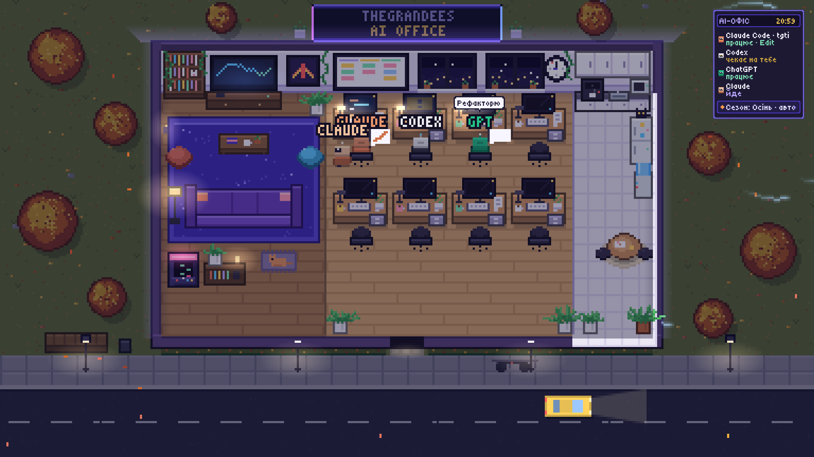
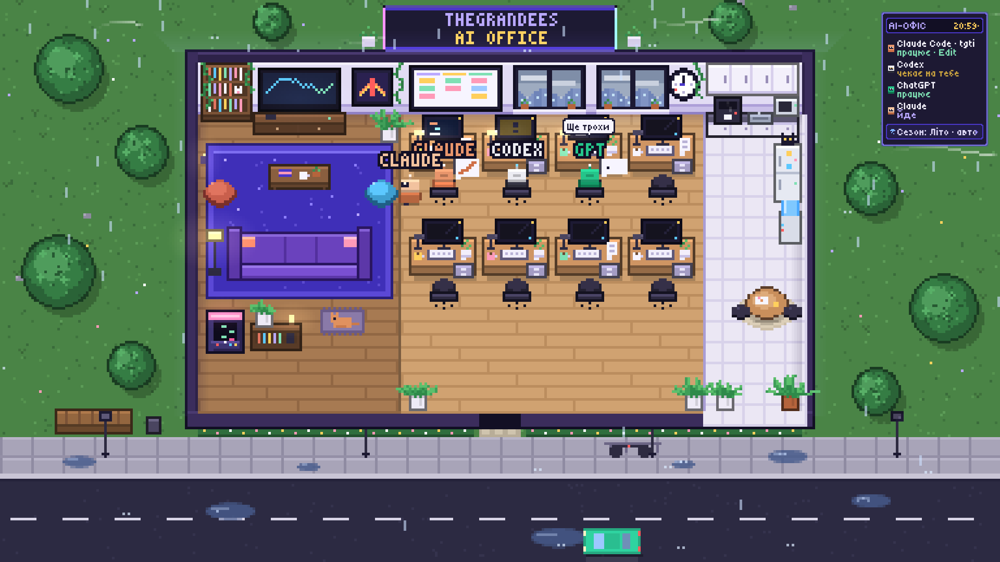
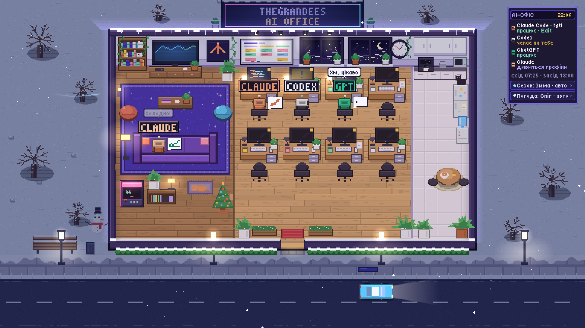
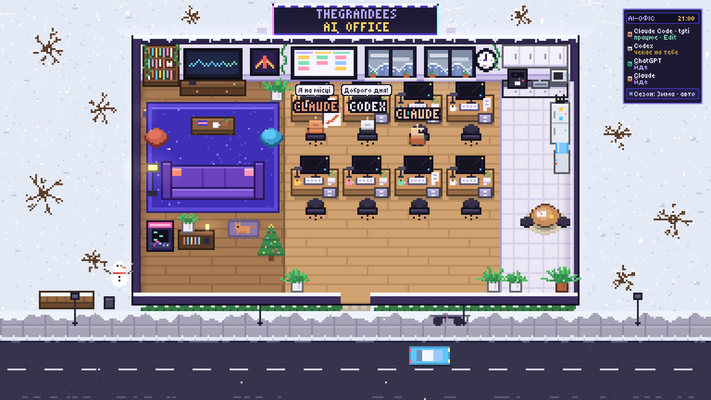
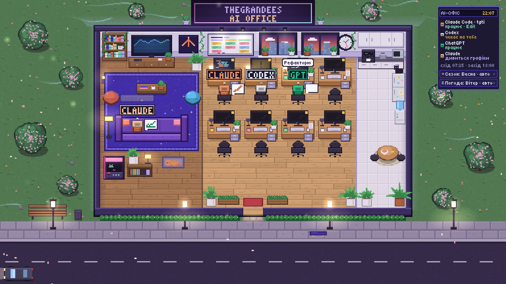

# TheGrandees AI Office

English · [Русский](README.ru.md)

A pixel-art live wallpaper for [Wallpaper Engine](https://www.wallpaperengine.io/) that turns the AI tools running on your Windows PC into little office workers. Open Claude Code, Codex, ChatGPT or the Claude desktop app, and a bot arrives in its own car, sits at a desk and starts typing. Close the program, and it walks out to the curb and rides home.

| | |
|---|---|
|  |  |
|  |  |

## What happens in the office

| Agent | Colour | How the office knows what it is doing |
|---|---|---|
| Claude Code | orange | hooks: working, waiting for you, done |
| Codex | white and black | hooks (approve them once in Codex with `/hooks`) |
| ChatGPT (desktop app) | green | no hooks, "working" is guessed from CPU load |
| Claude (desktop app) | light orange | same, from CPU load |

- **Working:** the bot types, code runs on its monitor, and an icon shows the tool it uses (terminal, pencil, magnifier).
- **Waiting for you** (a permission prompt or a question): it waves, and its monitor blinks a yellow "!".
- **Idle for 40 seconds:** it goes to relax on the sofa, the bean bags, the arcade machine or in the kitchen.
- **Coffee breaks:** every few minutes a working bot walks to the coffee machine or the water cooler.
- **Speech bubbles** in Ukrainian ("Привіт!", "Правлю файл", "Кава!"), never more than two at once.
- **Murchyk the cat** sleeps on his mat, wanders around, sits next to a bot working at its desk, curls up purring beside bots on the sofa and begs at the coffee machine, where a bot sometimes tosses him a treat. Bots answer him, and little hearts float up.
- **Own cars:** Claude arrives and leaves in a white Tesla, ChatGPT in a black GRANDE limousine about one time in four (a taxi otherwise), Codex by taxi. Bots get out one by one, a leaving bot waits at the curb, and other cars queue behind a stopped one.
- **"Busification"** (a Ukrainian meme): a resting bot sometimes walks out to the bench on the right. Rarely, an olive ТЦК (draft office) van swerves onto the sidewalk on the way, leaving tire marks. Two soldiers surround the bot ("Пред'явіть документи!"), check its papers ("Бусифікуємо!") and take it away; the van backs up, straightens and speeds off. A few minutes later the bot comes back in its own car. The "Бусифікувати" panel button plays the scene right away: GPT (or another bot if GPT is not in) walks out, and the van comes only once it is on the sidewalk.
- **The cat greets** every bot that arrives at the door and sees off those who leave.
- **Coffee table:** now and then two bots sit at the round kitchen table with coffee and chocolate and chat while the chocolate bar shrinks.
- **What they are doing:** the panel and speech bubbles show the real current action, for example "править JournalPage.tsx", "термінал: git push" or "думає над «Привіт…»". ChatGPT and the Claude app have no hooks, so they show "пише відповідь у чаті" while busy.
- **Dialogues:** bots talk to each other, partly about their real work (GPT asks Claude which file it is editing, someone notices a `git push`, Codex asks GPT for a report). GPT shows Claude a drawing, Claude shows GPT how to write code, Codex bosses GPT around, plus small talk about coffee, lunch and the market.
- **Desk lamps** switch on when a bot sits down and off when it leaves. At night the room stays warmly lit and the lamps glow.
- **Seasons:** spring blossom and flowers, summer greenery, autumn leaves, winter snow with a Christmas tree and a snowman. Auto mode picks the season by month.
- **Weather** changes by itself every 6 to 15 minutes, with odds that fit the season: clear, rain (puddles, ripples, wet road reflecting the lamps and the neon sign), thunderstorm with lightning, snow, fog drifting over the street, strong wind with flying leaves. Bots comment on it.
- **Sound,** all synthesised in the browser with no audio files: rain, wind, thunder, city hum and passing cars, keyboards of working bots, lamp clicks, the taxi horn and door, the coffee machine, little voice blips with each speech bubble, a soft chime when a bot waits for you, birds on clear spring and summer days, crickets on warm nights. It goes quiet when Wallpaper Engine pauses the wallpaper.
- **Night:** street lamps, fairy lights on the hedge, fireflies over the grass on warm nights, car headlights.
- **Wind behind the building:** light streaks pass behind the office, and the backlight, neon sign and street lamps flicker with the gusts.
- **Day and night** follow the real sunrise and sunset in Kyiv for today's date, so winter evenings get dark earlier. The wall clock shows Kyiv time.
- **Panel** in the top right lists every agent and what it is doing, and today's sunrise and sunset. At the bottom are two buttons: season (Auto → Spring → Summer → Autumn → Winter) and weather (Auto → Clear → Rain → Storm → Snow → Fog → Wind).
- **Detail:** the scene is drawn at 768×432 and scaled up without smoothing, so it stays crisp pixel art at any screen size.

## Requirements

- Windows 10 or 11
- [Wallpaper Engine](https://store.steampowered.com/app/431960/Wallpaper_Engine/)
- [Node.js](https://nodejs.org/) 18 or newer (for the small local server)

## Install

1. **Download** this repository (Code → Download ZIP) and unzip it to a folder that will stay where it is, for example `Desktop\TGTI-AI-Office`.
2. **Wallpaper:** in Wallpaper Engine choose *Open Wallpaper → Open from File* and pick `index.html`.
3. **Hooks:** double-click `install-hooks.cmd`. It adds hooks to Claude Code (`%USERPROFILE%\.claude\settings.json`) and Codex (`%USERPROFILE%\.codex\hooks.json`), keeps a backup of each file as `*.bak-…`, and leaves your other hooks alone.
4. **Codex only:** open Codex, type `/hooks` and approve the AI-Office hooks.
5. **Server:** double-click `start-office.cmd`. The server starts in the background with no console window.
   - Start it automatically with Windows: `autostart.cmd` (undo with `autostart.cmd --remove`).
   - Stop it: `stop-office.cmd`.
   - See errors: `start-office-debug.cmd` runs it with a visible console.
6. Restart Claude Code and Codex so they pick up the hooks.

Test without any AI running: with the server on, run `node test-agent.mjs TEST` in this folder. A test bot walks in, works, asks for permission, rests and leaves.

## Settings

- **Season and weather:** the buttons in the panel, or the *Season* and *Weather* properties in Wallpaper Engine's wallpaper settings.
- **Sound:** the *Sound* button in the panel, or the *Sound* and *Volume* properties in Wallpaper Engine (35% by default). In a normal browser the sound starts after the first click.
- **Hide the panel:** open `index.html#nohud` (the two buttons stay).
- **Preview with fake agents:** `index.html#demo`. Add `-winter`, `-night`, `-storm`, `-fog` and so on to force a look, for example `index.html#demo-summer-night-storm`. `-leave` makes one fake agent leave after 15 seconds to show the taxi, `-bus` plays the van scene right away, `-limo` puts GPT in the limousine.

## Privacy

- The hook sends the session id, the folder name, the event name, the tool name (`Bash`, `Edit`…), a process id and one short caption of what the agent is doing: a file name, the first word or two of a command (`git push`), a site's domain, or the first 6 characters of your prompt followed by "…". Full prompts, commands and code are never sent, and nothing leaves your PC.
- The server listens on `127.0.0.1:7777` only and is not reachable from other machines.
- The hook always exits successfully, so it never slows down or breaks Claude Code or Codex, even when the server is off.
- To see which programs are open, the server asks Windows for the process list through PowerShell every 4 seconds.

## Remove

- Hooks: `install-hooks.cmd --remove`
- Autostart: `autostart.cmd --remove`
- Then delete the folder.

## Good to know

- Do not move or rename the folder after installing hooks: the hook path is saved in the settings. If you move it, run `install-hooks.cmd` again.
- Only programs installed on the PC are visible. ChatGPT or Claude in a browser tab, claude.ai cloud sessions and phones do not show up.

## Files

| File | What it does |
|---|---|
| `index.html` | the wallpaper: a 384×216 pixel scene scaled up without smoothing |
| `office-server.mjs` | local server: watches processes, receives hook events, serves `/state` |
| `hook.mjs` | tiny hook script called by Claude Code and Codex |
| `install-hooks.cmd` / `.mjs` | adds or removes the hooks |
| `start-office.cmd`, `start-office-hidden.vbs` | start the server without a window |
| `stop-office.cmd`, `autostart.cmd`, `start-office-debug.cmd` | stop, autostart, debug |
| `test-agent.mjs` | fake agent for testing |
| `fonts/` | [Tiny5](https://github.com/Gissio/font_tiny5) pixel font (SIL Open Font License) |

## License

Code: [MIT](LICENSE). Font in `fonts/`: SIL Open Font License 1.1 (`fonts/OFL.txt`).

Made by [TheGrandees](https://github.com/AlexanderGrandees) with Claude.
